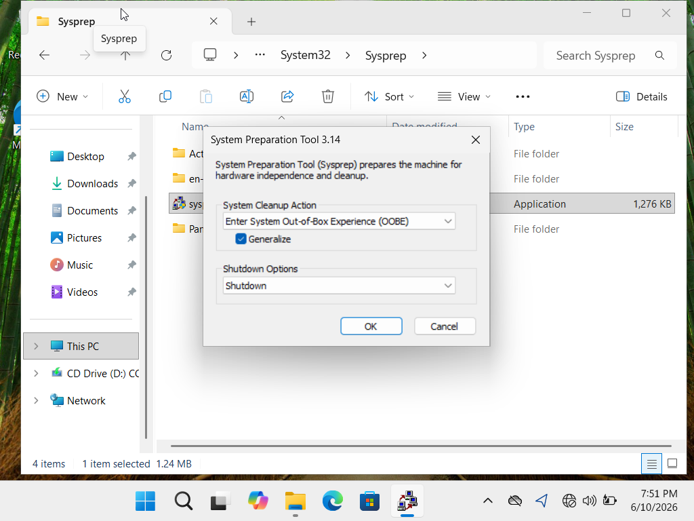
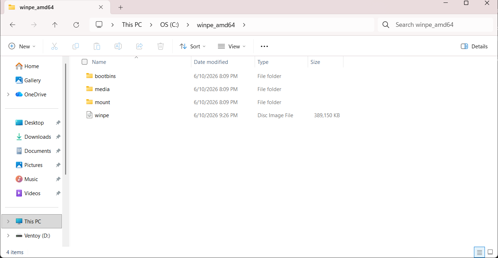
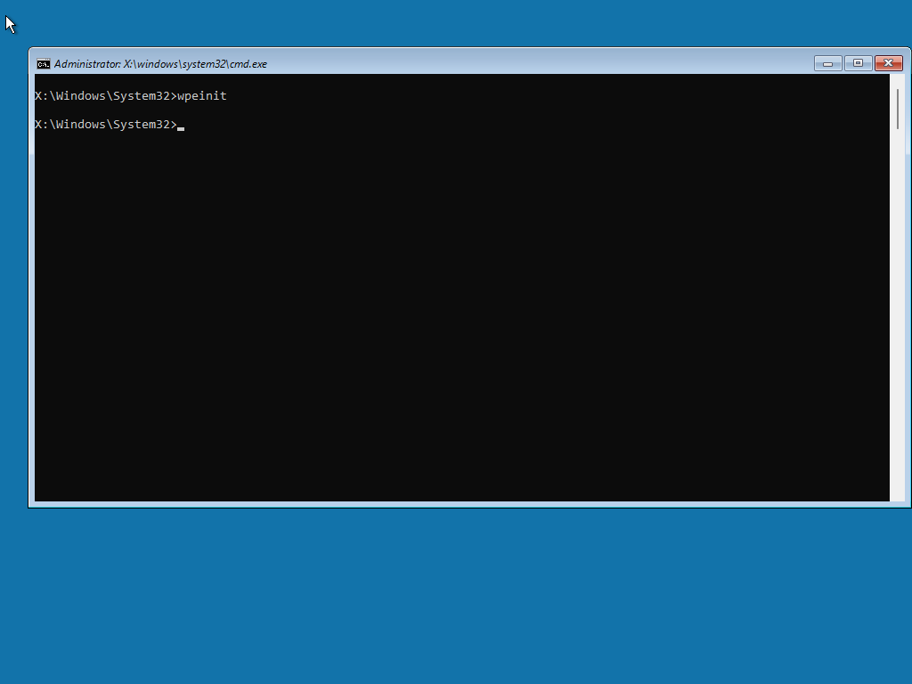
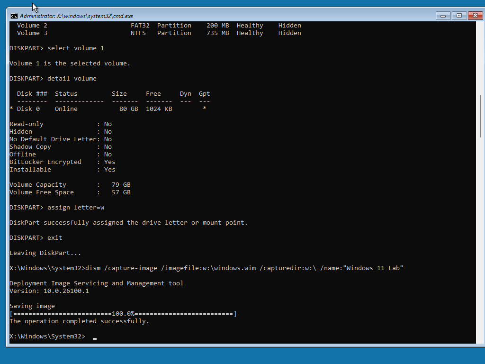
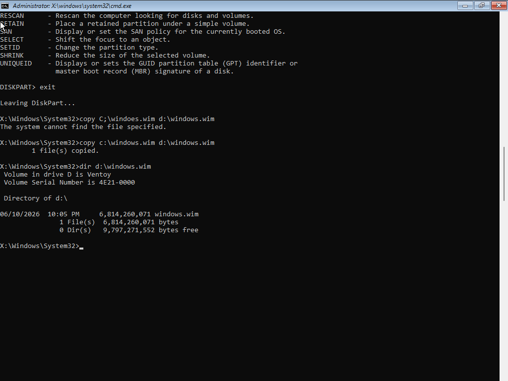
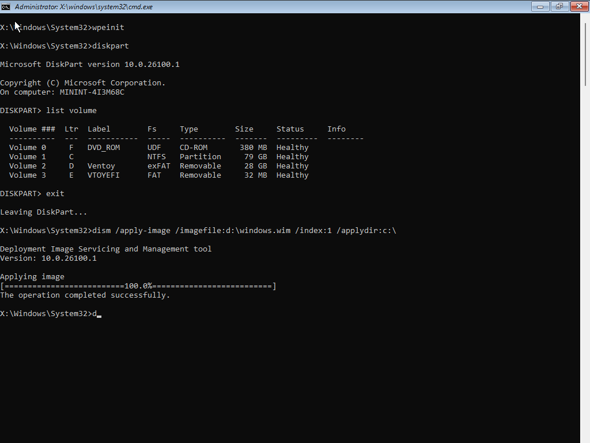
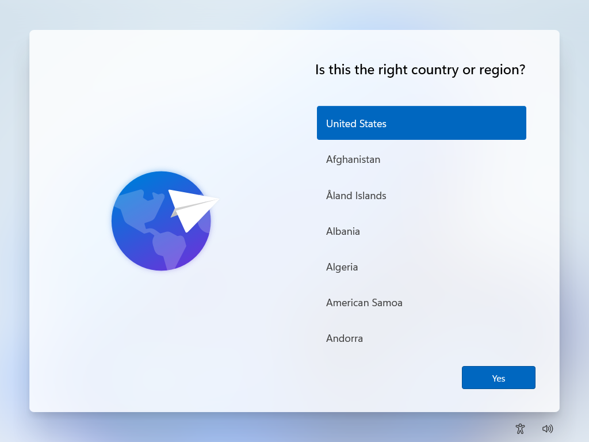

# Windows OS Imaging Lab: Capture and Deploy

A hands-on Windows 11 home lab focused on building, capturing, and deploying a generalized Windows image using **Sysprep, Windows Preinstallation Environment (WinPE), and DISM**.

I built a Windows 11 virtual machine, prepared it for deployment, captured the installation into a Windows Imaging Format (`.wim`) file, and applied that image to a blank virtual machine. After troubleshooting boot configuration issues, the deployed system successfully reached the Windows first-run setup screen.

## Skills Demonstrated

- Windows operating system imaging and deployment
- Sysprep and image generalization
- Windows PE (WinPE) boot environments
- DISM image capture and application
- Disk partitioning and boot configuration
- Virtualization with Oracle VirtualBox
- BIOS boot troubleshooting
- Technical documentation and troubleshooting

## Lab Environment

| Component | Configuration |
|---|---|
| Host machine | Dell Plus 14-inch 2-in-1, Windows 11 Home, 16 GB RAM, 512 GB SSD |
| Hypervisor | Oracle VirtualBox |
| Source VM | Windows 11 Home 25H2, 6 GB RAM, 2 vCPUs, 80 GB dynamic virtual disk |
| Target VM | Blank virtual machine, 4 GB RAM, 2 vCPUs, 80 GB dynamic virtual disk |
| Imaging tools | Sysprep, Windows ADK Deployment Tools, WinPE, DISM, DiskPart, BCDBoot |
| Transfer media | Ventoy USB drive with an exFAT data partition |

## Imaging Workflow

### 1. Prepare and Generalize the Source VM

Installed Windows 11 Home 25H2 in a VirtualBox virtual machine. Once the installation was ready for capture, launched Sysprep and configured:

- **System Cleanup Action:** Enter System Out-of-Box Experience (OOBE)
- **Generalize:** Enabled
- **Shutdown Options:** Shutdown

Generalization prepares the Windows installation for deployment by removing system-specific information and returning Windows to its first-run setup experience.

### 2. Build the WinPE Environment

Installed the Windows Assessment and Deployment Kit (ADK) Deployment Tools and the Windows PE add-on. Used the Deployment and Imaging Tools Environment to create a working directory and build a bootable WinPE ISO.

Booted the source VM from the WinPE ISO to work with the Windows installation while it was offline.

### 3. Capture the Windows Image

Used DiskPart to identify the Windows volume and assign it a drive letter. Then used DISM to capture the offline Windows installation into a Windows Imaging Format (`.wim`) file.

The capture completed successfully, producing a WIM image of approximately 6.3 GB.

### 4. Transfer the Image

Copied the captured WIM image to a Ventoy-formatted USB drive so it could be accessed by the target VM. This provided a way to transfer the image between the two isolated virtual machines.

### 5. Deploy to the Target VM

Created a blank target VM and booted it into WinPE. Prepared the target disk using DiskPart, applied the captured image using DISM, and created boot files using BCDBoot.

The target was configured for legacy BIOS-style booting with an MBR-compatible partition layout.

### 6. Verify the Deployment

Detached the WinPE ISO, set the virtual hard disk as the first boot device, and started the target VM.

**Result:** The deployed Windows installation booted successfully and reached the Windows first-run setup screen.

## Troubleshooting and Lessons Learned

### File Path and Drive-Letter Troubleshooting
- Encountered a file-not-found error during the initial WIM copy attempt.
- Corrected the source path and verified the image was present on the destination USB drive.
- Used directory listings to confirm the file copy completed successfully.

### Boot Configuration Troubleshooting
- Investigated boot issues after applying the Windows image to the target VM.
- Reviewed the virtual machine's boot configuration and disk layout.
- Corrected the boot setup and verified that the deployed Windows installation reached the first-run setup screen.

### Key Takeaways
- Windows imaging requires careful management of drive letters and disk layouts in WinPE.
- DISM can capture and apply Windows images independently of a running Windows installation.
- A successfully applied image still requires a compatible partition layout and boot configuration.
- Verifying the final boot process is essential to confirming a successful deployment.
